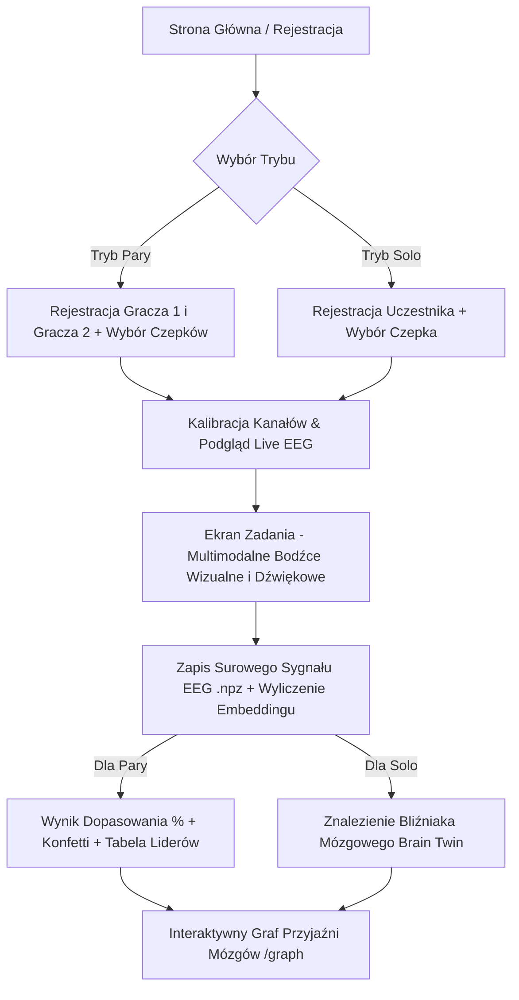

# Neuro-Randki (EEG Love Tester & Brain Friendship Graph)

**Neuro-Randki** to biometryczna aplikacja w stylu "Love Tester" oraz interaktywny "Graf Przyjaźni Mózgów", zaprojektowana dla wydarzeń, lodołamaczy (ice-breakers) i imprez integracyjnych. Dwóch użytkowników (lub pojedynczy gracze w trybie solo) podłączają zestawy słuchawkowe EEG, wykonują zsynchronizowane zadania z bodźcami wizualno-słuchowymi, a podobieństwo ich fal mózgowych jest analizowane za pomocą ekstrakcji cech oraz sieci neuronowych PyTorch (`MasterEEGNet`).


---

## 🌟 Kluczowe Funkcje

- 💖 **Tryb Pary (Love Tester):** Dwóch graczy rywalizuje/bada poziom dopasowania fal mózgowych. Po zakończeniu sekwencji bodźców generowany jest wynik procentowy, animacja konfetti, miejsce w tabeli liderów par oraz kod QR odsyłający do grafu.
- 🧠 **Tryb Solo i "Bliźniak Mózgowy" (Brain Twin):** Możliwość samodzielnego wykonania badania bez pary. Po zapisaniu odcisku neuronowego aplikacja wyszukuje w bazie najbardziej pasującego uczestnika i wskazuje poziom zgodności.
- 🕸️ **Interaktywny Graf Przyjaźni Mózgów (D3.js):** Wizualizacja 2D w czasie rzeczywistym przedstawiająca powiązania fal mózgowych między wszystkimi uczestnikami wydarzenia.
  - Wyszukiwarka uczestników po pseudonimie.
  - Wykresy fal neuronowych w czasie rzeczywistym i wskaźniki pasm EEG (Delta, Theta, Alpha, Beta, Gamma).
  - Ranking powiązań oraz szczegółowy podgląd pasm i najbliższych "mózgowych sąsiadów".
- 🎧 **Integracja ze Sprzętem EEG BrainAccess:**
  - Skanowanie urządzeń przez Bluetooth i automatyczne wykrywanie czepków.
  - Obsługa wielu urządzeń jednocześnie (osobne czepki dla Gracza 1 i Gracza 2).
  - Automatyczna kalibracja jakości sygnału i dobór 4 najlepszych kanałów.
  - Podgląd sygnału EEG na żywo (*Live EEG Preview*).
- 🤖 **Automatyczny Tryb MOCK:** W przypadku braku fizycznego czepka lub SDK BrainAccess, aplikacja przełącza się automatycznie w tryb symulacji, pozwalając na pełne przetestowanie interfejsu.
- 🔬 **3 Metody Embeddingu Mózgowego:**
  1. `handcrafted`: Ekstrakcja 13 zaawansowanych cech fizycznych na kanał (logarytm mocy pasmowej, parametry Hjortha: mobilność i złożoność, momenty statystyczne, percentyle).
  2. `neural`: Głębokie reprezentacje wygenerowane przez sieć `MasterEEGNet` w PyTorch (wektor 128D z modelu `models/openset_master_best.pth`).
  3. `hybrid`: Połączenie wektorów cech fizycznych i głębokich reprezentacji neuronowych.
- 🛠️ **Panel Administratora (`/admin`):**
  - Zmiana metody embeddingu na żywo oraz konfiguracja kanałów.
  - Masowe przeliczanie (*recompute*) zapisanych surowych sygnałów `.npz` nową metodą.
  - Eksport kompletnych danych uczestników i mocy pasm EEG do pliku CSV (`/admin/export`).
  - Zarządzanie i usuwanie wpisów z bazy.
- 🎨 **Stylowy Interfejs Kiosku:** Wygodny układ dla ekranu eventowego z przyciskiem przełączania motywu (**Tryb Jasny / Tryb Mroczny**), czcionką *Oxanium*, autorskimi ilustracjami SVG oraz dynamicznym podglądem zadań.

---

## 🎬 Tryb wspólnego bodźca (główna metoda dopasowania)

Każdy uczestnik ogląda **tę samą** sekwencję kolorów: szary na zmianę z czerwonym, zielonym, niebieskim lub żółtym, każdy bodziec po 3 s, domyślnie 120 bodźców ≈ 6 min. Kolejność jest losowana raz, ze stałym ziarnem. Dla każdej osoby liczymy **podpis reakcji**, czyli uśrednioną odpowiedź mózgu (ERP, 1–20 Hz, −0.2…1.0 s) na każdy kolor. Podobieństwo dwóch osób to korelacja ich podpisów po odjęciu reakcji wspólnej dla całej populacji. W wyniku pary jest to wymiar **🎬 Wspólna reakcja**, który stanowi 70% wyniku ogólnego.

Dlaczego tak, a nie z widma spoczynkowego: na 30 nagraniach z `data/` graf z widma krótkiego nagrania nie powtarzał się między dwoma pomiarami (ρ ≈ 0.1), a w dużej mierze odzwierciedlał dopasowanie headsetu. Graf z podpisów reakcji przy tym protokole powtarza się między dwoma niezależnymi blokami po 6 min z ρ ≈ 0.62. Ta sama osoba jako najbliższa wypada w 33% przypadków (losowo 3%), top-3 pokrywa się w 28% (losowo 10%). Graf nie zależy od amplitudy ani szumu 50 Hz (ρ ≈ 0.02). Ograniczenia: 30 osób, jedna sesja na osobę. Stabilny podpis to cecha osobnicza (m.in. anatomia kory wzrokowej), a nie dowód zgodności charakterów.

Synchronizacja: przeglądarka wysyła znacznik każdego bodźca (`/api/eeg/mark`) z czasem klatki (`performance.now()` w `requestAnimationFrame`). Serwer usuwa przesunięcie zegarów i jitter sieci, a znaczniki mapuje na numery próbek na podstawie czasów nadejścia paczek z headsetu (`shared_stimulus.markers_to_samples`). Jakość podpisu to powtarzalność między połowami prób (split-half r). Poniżej 0.10 wynik jest oznaczany jako orientacyjny. Bez headsetu (tryb MOCK) aplikacja używa prawdziwego nagrania jednej z osób z `data/` z jej własnymi znacznikami.

Operator może przerwać zadanie skrótem **Shift+Q**. Mniej bodźców oznacza mniej wiarygodny podpis.

---

## 🏗️ Architektura i Stos Technologiczny

- **Backend:** Python 3, Flask
- **Przetwarzanie Sygnałów i ML:** NumPy, SciPy, PyTorch (`MasterEEGNet`)
- **Baza Danych i Przechowywanie:** SQLite (`neuro_randki.db`) z automatyczną migracją + skompresowane pliki surowych sygnałów `.npz` w `recordings/`
- **Frontend:** HTML5, Vanilla CSS3 (z obsługą dynamicznego Dark Mode), JavaScript (ES6+), D3.js v7 (Graf), QRCode.js, Canvas Confetti
- **Sprzęt EEG:** BrainAccess SDK (`brainaccess` Python package) z fallbackiem do symulatora

---

## 🔄 Przepływ Użytkownika



---

## 🚀 Szybkie Uruchomienie

### 1. Automatyczne uruchomienie (Zalecane)

Skrypt `run.sh` automatycznie sprawdza środowisko Python, instaluje brakujące pakiety (`flask`, `numpy`, `scipy`, `torch` CPU wheel), inicjalizuje bazę danych SQLite, zamyka ewentualne kolidujące procesy na porcie 5000 i uruchamia serwer.

```bash
chmod +x run.sh
./run.sh
```

Aplikacja będzie dostępna pod adresem:
- **Aplikacja:** [http://127.0.0.1:5000](http://127.0.0.1:5000)
- **Graf Przyjaźni:** [http://127.0.0.1:5000/graph](http://127.0.0.1:5000/graph)
- **Panel Admina:** [http://127.0.0.1:5000/admin](http://127.0.0.1:5000/admin)

---

### 2. Ręczna instalacja i uruchomienie

Jeśli wolisz uruchomić aplikację bez skryptu pomocniczego:

```bash
# 1. Zainstaluj wymagane pakiety
pip install -r requirements.txt

# 2. (Opcjonalnie) Ustaw metodę embeddingu
export EMBED_METHOD="handcrafted" # opcje: handcrafted | neural | hybrid
export NEURAL_CHANNELS="0,1,2,3"

# 3. Uruchom serwer Flask
python app.py
```

---

## 🛠️ Panel Admina i Zmienne Konfiguracyjne

### Zmienne Środowiskowe
- `EMBED_METHOD`: Ustawia domyślną algorytmiczną metodę wyliczania podobieństwa (`handcrafted`, `neural`, `hybrid`).
- `NEURAL_CHANNELS`: Kanały przekazywane do modelu PyTorch (np. `0,1,2,3`).
- `STIM_TRIALS`: Liczba bodźców w zadaniu wspólnego bodźca (domyślnie `120` ≈ 6 min). Skrócenie mocno obniża wiarygodność: przy ~2 min ρ ≈ 0.16.
- `EEG_LATENCY_MS`: Stałe opóźnienie sprzętu (Bluetooth + ekran) w ms, domyślnie `0`. Zmierz raz, np. fotodiodą. Nie wpływa na porównania między osobami nagranymi tym samym headsetem, ale jest potrzebne, żeby ich podpisy pasowały do uczestników demo z `data/`.

### Dostęp do Panelu Admina (`/admin`)
Panel administratora umożliwia:
- Podgląd zarejestrowanych uczestników i statusu ich wektorów cech.
- Eksport danych w formacie CSV (`/admin/export`) – zawiera identyfikatory, pseudonimy, tryb oraz średnie stosunki pasm fal (delta, theta, alpha, beta, gamma).
- Przełączanie metody embeddingu bez konieczności ponownego uruchamiania serwera.
- Przeliczenie wszystkich historycznych zapisów surowych fal EEG w katalogu `recordings/` za pomocą przycisku **"Przelicz wszystkie"**.

---

## 📁 Struktura Projektu

```text
neuro-randki/
├── app.py              # Główny serwer Flask, ścieżki routingu i REST API
├── eeg.py              # Moduł obsługi sprzętu BrainAccess EEG, Bluetooth, skanowania i MOCK
├── model.py            # Model MasterEEGNet (PyTorch), ekstraktory cech (handcrafted/neural/hybrid)
├── shared_stimulus.py  # Protokół wspólnego bodźca: sekwencja, synchronizacja znaczników, podpisy reakcji
├── matching.py         # Archetypy i wynik dopasowania (wspólna reakcja + wymiary pasmowe), graf
├── seed_data.py        # Uczestnicy demo z nagrań data/*.fif (z protokołem bodźca)
├── database.py         # Obsługa SQLite, nawiązywanie połączeń i migracje schematu
├── schema.sql          # Schemat tabel bazy danych (user, session, result)
├── run.sh              # Automatyczny skrypt konfigurujący środowisko i uruchamiający aplikację
├── requirements.txt    # Zależności Python
├── models/             # Wagi modeli PyTorch (openset_master_best.pth)
├── recordings/         # Zapisane surowe pliki sygnałów EEG (.npz)
├── static/
│   ├── assets/         # Pliki graficzne (SVG, tła, ikony serc)
│   ├── css/            # Style CSS (style.css z motywem jasnym i ciemnym)
│   └── js/             # Skrypty klienckie JS
└── templates/          # Szablony HTML Jinja2
    ├── base.html       # Główny szablon z nagłówkiem i stopką
    ├── register.html   # Wybór czepków i rejestracja pary
    ├── solo.html       # Rejestracja trybu solo
    ├── waiting.html    # Kalibracja czepka, live EEG preview i odliczanie
    ├── task.html       # Multimodalny ekran zadań z bodźcami
    ├── results.html    # Wyniki pary, konfetti i leaderboard
    ├── solo_results.html # Wyniki solo i prezentacja "Bliźniaka Mózgowego"
    ├── graph.html      # Interaktywny Graf Przyjaźni D3.js
    └── admin.html      # Panel zarządczy admina i eksport danych
```

---

## 📜 Licencja & Prawa Autorskie

&copy; 2026 Technologia Neuroguard / KN Neuron. Projekt stworzony dla wydarzeń i prezentacji biometrycznych.

